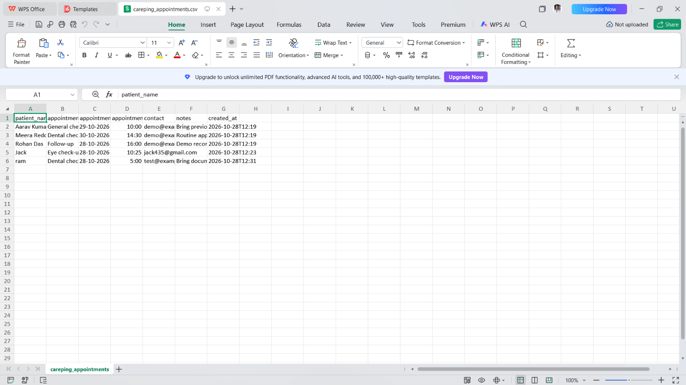

# CarePing — Healthcare Appointment Reminder

CarePing is a simple educational web application built with Streamlit to help organize healthcare appointments and track upcoming visits. It was developed as a one-day, AI-assisted project for an AI Skills & Prompt Engineering assessment.

## Features

- Add appointments with a patient name, visit type, date, time, contact information, and notes.
- View appointments sorted by date and time.
- Highlight appointments scheduled for today and the next seven days.
- Load fictional sample appointments for quick demonstrations.
- Remove selected appointments.
- Export appointment records as a CSV file.
- Use a clean, responsive Streamlit interface.

## Screenshots

### Dashboard


### Appointments


### Records


### Create Appointment


## Technology Stack

- **Programming Language:** Python
- **Web Framework:** Streamlit
- **Data Handling:** Pandas
- **Data Export:** CSV

## Important Limitations

- CarePing is an educational demonstration project, not a production-ready healthcare system.
- It does not send real SMS, email, or push notifications, or create calendar invitations.
- Appointment data is stored in Streamlit session memory and may be lost when the session resets.
- Use fictional data only. Do not enter real patient information or other sensitive personal details.
- The application does not provide medical advice.

## Prerequisites

Before running the project, install:

- Python 3.10 or newer
- Visual Studio Code (VS Code), recommended
- PowerShell or another terminal

## Installation and Setup on Windows

### Step 1: Open the Project

Download or clone the repository and open the project folder containing `app.py` in VS Code.

### Step 2: Open the Terminal

In VS Code, select **Terminal → New Terminal**.

### Step 3: Create a Virtual Environment

```powershell
py -m venv .venv
```

### Step 4: Activate the Virtual Environment

```powershell
.\.venv\Scripts\Activate.ps1
```

### Step 5: Install Dependencies

```powershell
python -m pip install --upgrade pip
pip install -r requirements.txt
```

### Step 6: Run the Application

```powershell
streamlit run app.py
```

A browser tab should open automatically. If it does not, open the local URL displayed in the terminal, usually:

`http://localhost:8501`

### Alternative if PowerShell Blocks Activation

Run the following commands from the project directory:

```powershell
.\.venv\Scripts\python.exe -m pip install -r requirements.txt
.\.venv\Scripts\python.exe -m streamlit run app.py
```

## Suggested Demo Flow

1. Click **Load sample appointments** in the sidebar.
2. Show the Total Appointments, Today, and Next 7 Days dashboard metrics.
3. Open the appointments section and demonstrate the scheduled appointments.
4. Create a new appointment using fictional details.
5. Remove a selected sample appointment.
6. Export the appointment records as a CSV file.

## Project Structure

```text
healthcare_appointment_reminder/
├── app.py
├── requirements.txt
├── README.md
├── PROMPT_DOCUMENTATION.md
├── VIDEO_PRESENTATION_SCRIPT.md
├── .gitignore
└── screenshots/
    ├── Appoinments.png.png
    ├── Dashboard.png (2).png
    ├── create appoinment.png.png
    └── Records.png.png
```

## Assessment Submission Checklist

- [ ] Upload the project to a public GitHub repository or provide another accessible project link.
- [ ] Record a presentation video of at least two minutes.
- [ ] Include prompt documentation and meaningful prompt revisions.
- [ ] Test the application on the machine used for the demonstration.
- [ ] Include screenshots showing the application's main features.
- [ ] Describe the application's features and limitations accurately.
- [ ] Do not claim that the application sends real reminders or uses an AI model at runtime unless those features have actually been implemented and tested.

## Learning Outcomes

This project demonstrates practical experience with:

- Python application development
- Streamlit interface design
- Appointment data management
- Date-based appointment tracking
- CSV file export
- AI-assisted development and prompt engineering

---

**CarePing — A simple way to organize upcoming healthcare appointments.**
